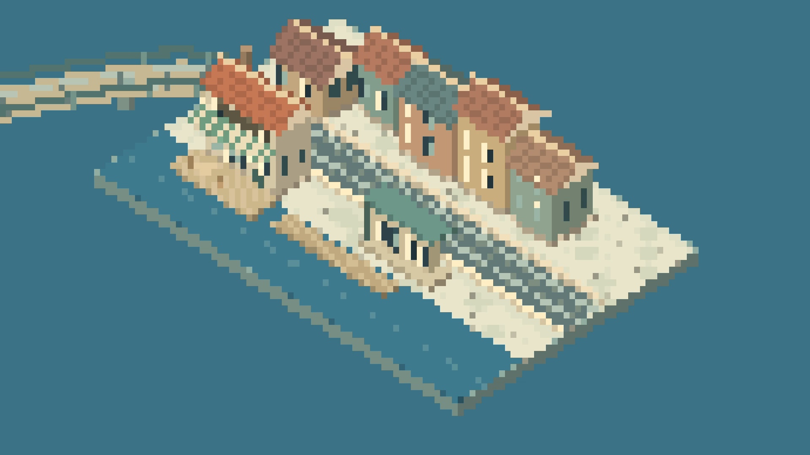
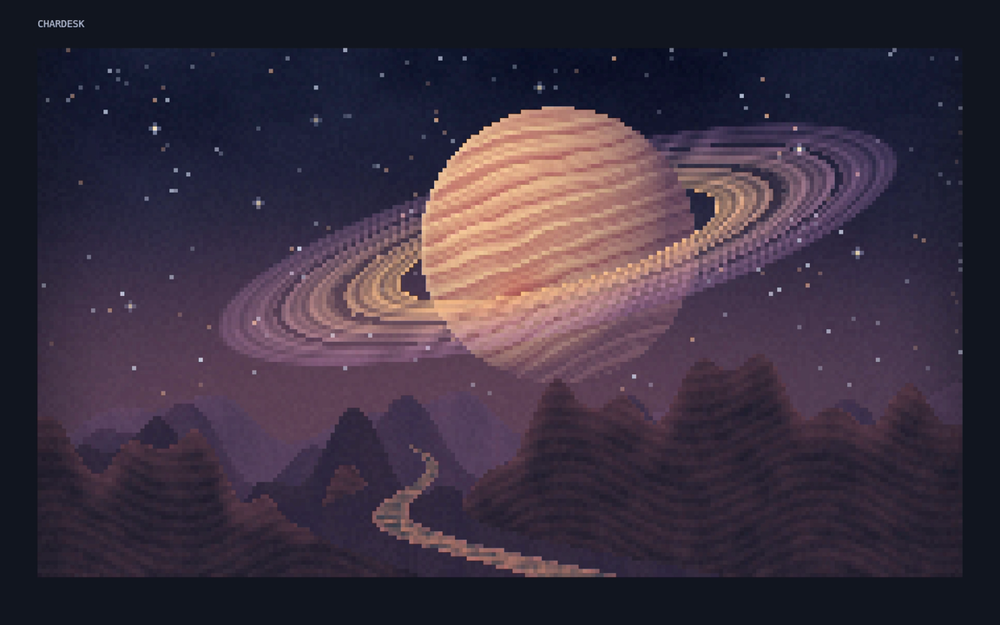
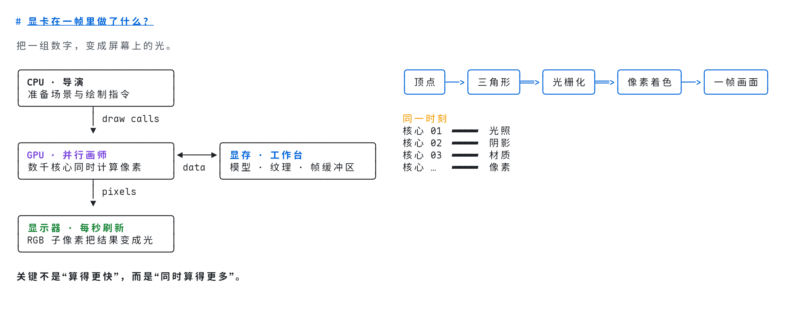
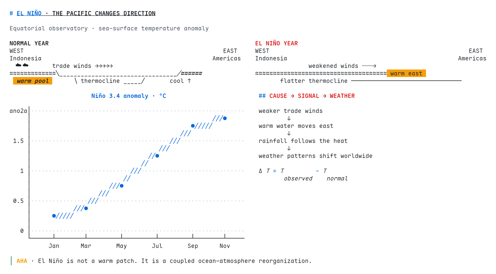
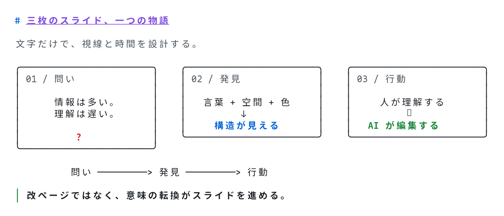
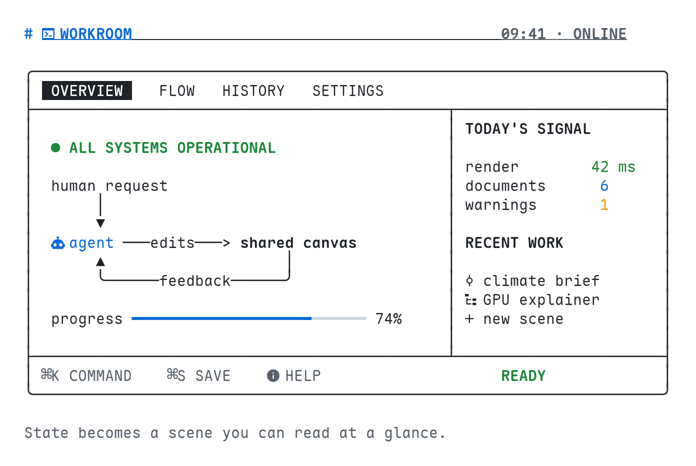

[English] | [简体中文](./README.zh-CN.md)

# CharDesk

> **A shared visual medium for people and agents.**

CharDesk turns editable Unicode text into diagrams, slides, and interfaces.

## Why we built CharDesk

People read spatial relationships at a glance. Language models can make precise edits to text. We built CharDesk so people and agents could work on the same artifact.

A fixed Unicode grid preserves position, box drawing gives it structure, and ANSI carries style. An agent can edit a small part as text, a person can review the change in place, and both can compare versions of the source.

## Choose where to start

| Entry point | What it’s for |
| --- | --- |
| [Web Canvas](https://canvas.chardesk.com/) | Draw, edit, and share on an infinite canvas in your browser. |
| [Terminal Canvas (TUI)](https://docs.chardesk.com/terminal/) | Open and edit local canvases in your terminal with `chardesk`. |
| [Cell UI](https://ui.chardesk.com/) | Build interactive React interfaces on a character grid. |
| [CharGraph](https://chardesk.com/chargraph/) | Turn Markdown, Mermaid, and other structured sources into character graphics. |
| [Documentation](https://docs.chardesk.com/) | Find setup, product guides, and troubleshooting. |

## Work with an agent

Use the [CharDesk Skill](https://docs.chardesk.com/agents/skill/) for authoring guidance. Connect an agent to Web Canvas with [Local MCP](https://docs.chardesk.com/agents/connect/) or [WebMCP](https://docs.chardesk.com/agents/webmcp/). Use the [CLI](https://docs.chardesk.com/cli/) to read and edit local files or terminal sessions.

## Examples

**Port Sol** · [Terminal recording](assets/videos/port-sol-native/port-sol-native.mp4) · [Editable Canvas](assets/videos/port-sol-native/port-sol.chardesk)

**Ring Canyon** · 104 simulated agents fill a shared canvas through diffusion. [Video](assets/videos/ring-canyon/ring-canyon.mp4) · [Editable Canvas](assets/videos/ring-canyon/ring-canyon.chardesk)

**Visual explanation** · [Source](apps/site/showcase-sources/02-gpu-blackboard.zh-CN.md)

**Scientific figure** · [Source](apps/site/showcase-sources/03-el-nino-observatory.md)

**Character slides** · [Source](apps/site/showcase-sources/04-story-slides.ja.md)

**Interface sketch** · [Source](apps/site/showcase-sources/05-interface-console.md)

[More examples](apps/site/showcase-sources/) · [Product home](https://chardesk.com/)

## For builders

[Protocol](packages/protocol/README.md) for interchange · [Viewer](packages/viewer/README.md) for framework-independent rendering · [Fonts](packages/fonts/README.md) for the compatible glyph set.

## Thanks

Thanks to [LINUX DO](https://linux.do/).

## License

[MIT](LICENSE)
