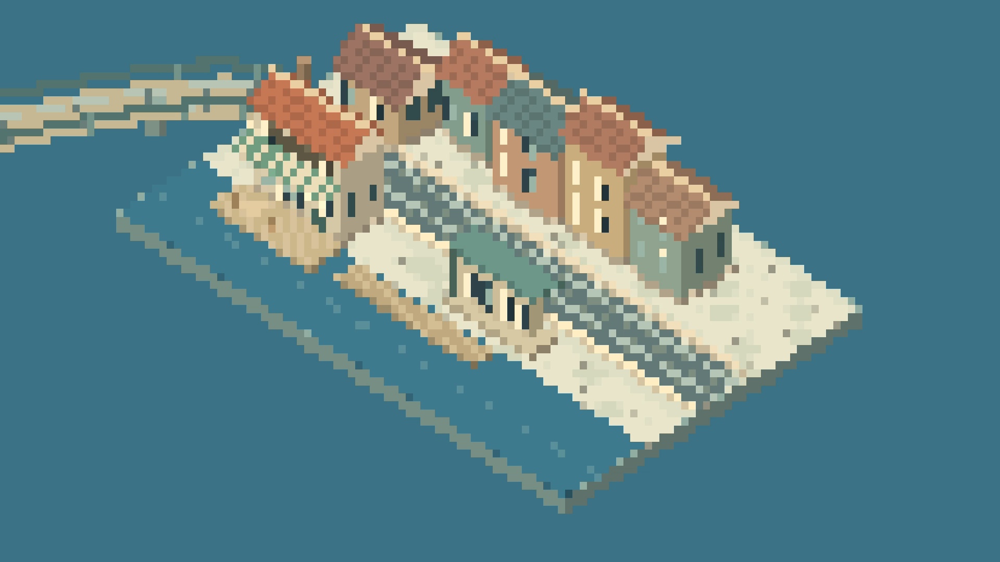
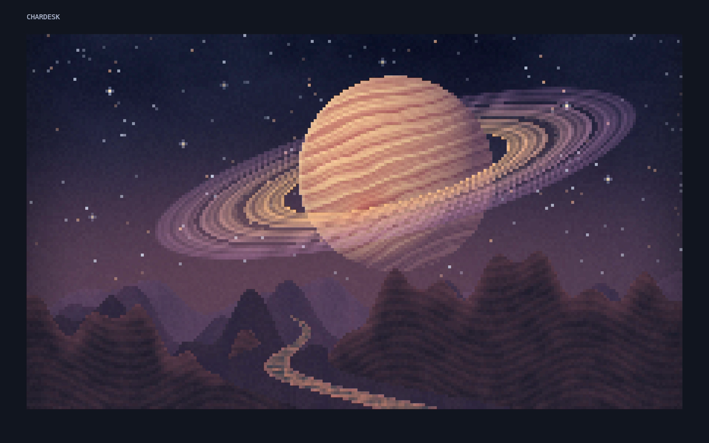
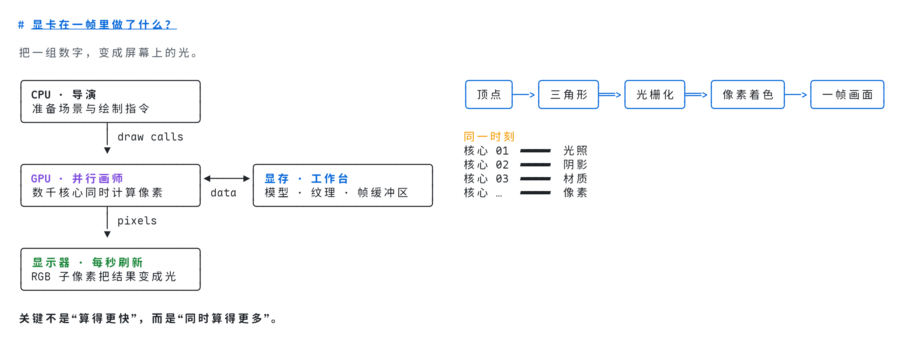
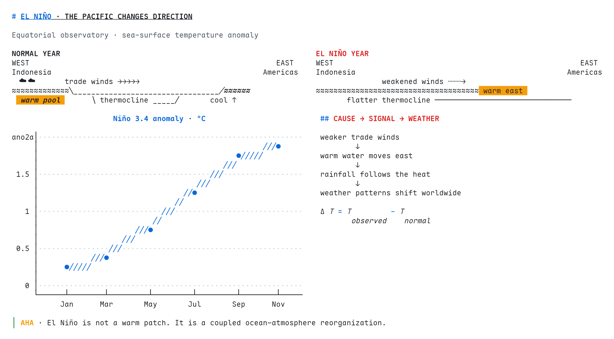
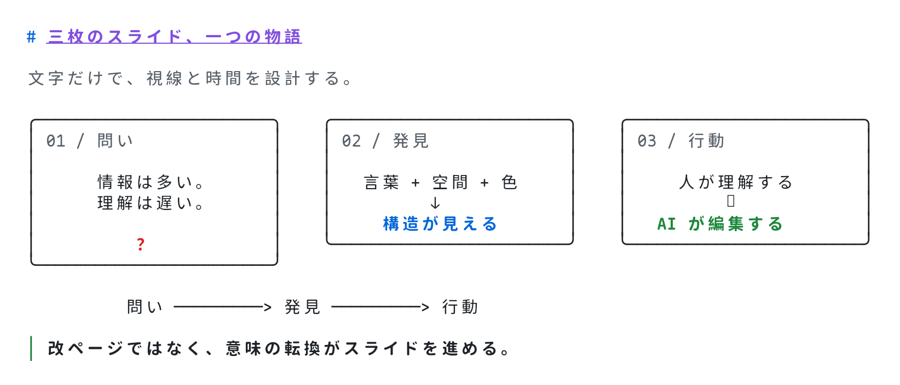
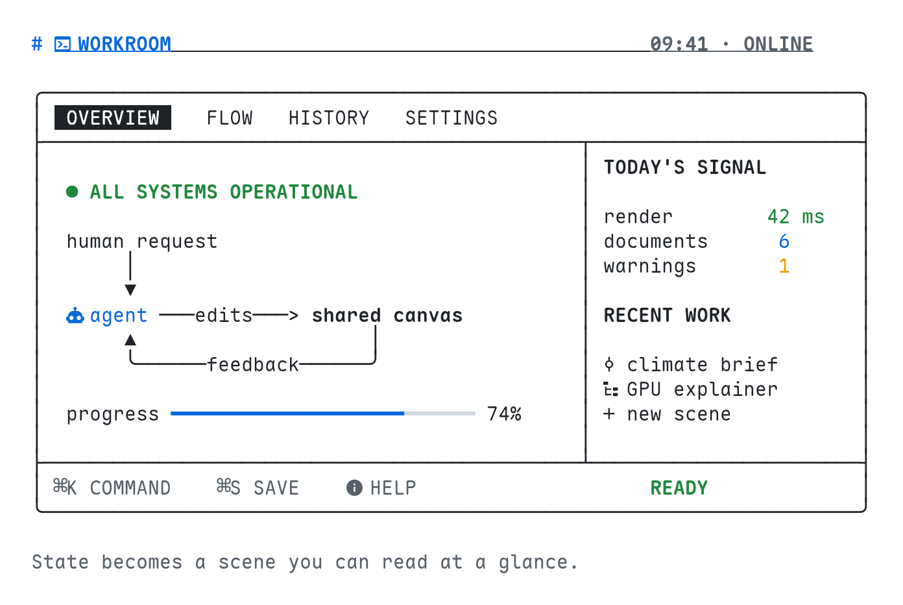

[English](./README.md) | [简体中文]

# CharDesk

> **人与 Agent 共享的视觉媒介。**

CharDesk 用可编辑的 Unicode 文本制作图解、幻灯片和界面。

## 为什么做 CharDesk

人能一眼看出二维画面里的空间关系，语言模型擅长精确修改文本。我们做 CharDesk，是为了让人和 Agent 能在同一份作品上协作。

固定的 Unicode 网格保留位置，框线表达结构，ANSI 表达样式。Agent 可以用文本修改一小块内容，人可以在画布原处检查结果，双方也能比较源码的不同版本。

## 选择入口

| 入口 | 用途 |
| --- | --- |
| [Web Canvas](https://canvas.chardesk.com/) | 在浏览器的无限画布上绘制、编辑和分享。 |
| [Terminal Canvas（TUI）](https://docs.chardesk.com/terminal/) | 运行 `chardesk`，在终端打开和编辑本地画布。 |
| [Cell UI](https://ui.chardesk.com/) | 在字符网格上构建交互式 React 界面。 |
| [CharGraph](https://chardesk.com/chargraph/) | 将 Markdown、Mermaid 等结构化源码转换成字符图。 |
| [使用文档](https://docs.chardesk.com/) | 查看安装、产品用法和故障排查。 |

## 与 Agent 一起工作

用 [CharDesk Skill](https://docs.chardesk.com/agents/skill/) 给 Agent 提供创作指南。用 [Local MCP](https://docs.chardesk.com/agents/connect/) 或 [WebMCP](https://docs.chardesk.com/agents/webmcp/) 接入 Web Canvas。用 [CLI](https://docs.chardesk.com/cli/) 读取和修改本地文件或终端会话。

## 示例

**Port Sol** · [终端实录](assets/videos/port-sol-native/port-sol-native.mp4) · [可编辑画布](assets/videos/port-sol-native/port-sol.chardesk)

**Ring Canyon** · 104 个模拟 Agent 以扩散方式写入同一块画布。[视频](assets/videos/ring-canyon/ring-canyon.mp4) · [可编辑画布](assets/videos/ring-canyon/ring-canyon.chardesk)

**可视化讲解** · [源码](apps/site/showcase-sources/02-gpu-blackboard.zh-CN.md)

**科研图** · [源码](apps/site/showcase-sources/03-el-nino-observatory.md)

**字符幻灯片** · [源码](apps/site/showcase-sources/04-story-slides.ja.md)

**界面草图** · [源码](apps/site/showcase-sources/05-interface-console.md)

[更多示例](apps/site/showcase-sources/) · [产品首页](https://chardesk.com/)

## 面向开发者

[Protocol](packages/protocol/README.md) 用于格式交换 · [Viewer](packages/viewer/README.md) 用于框架无关的渲染 · [Fonts](packages/fonts/README.md) 提供兼容字形。

## 致谢

感谢 [LINUX DO](https://linux.do/) 社区。

## 许可证

[MIT](LICENSE)
